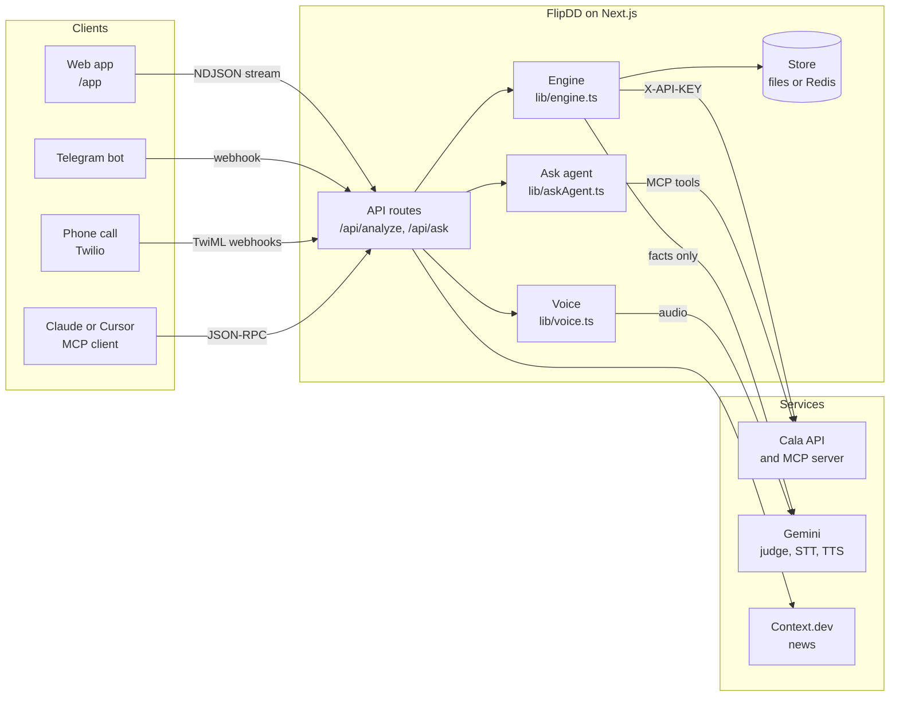
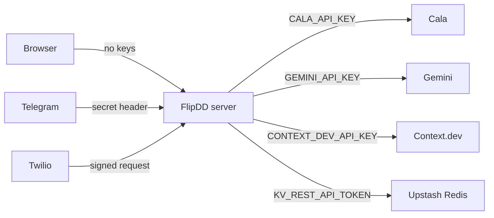
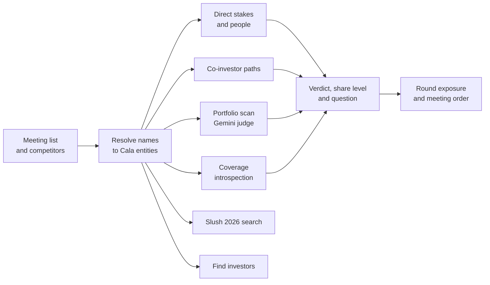
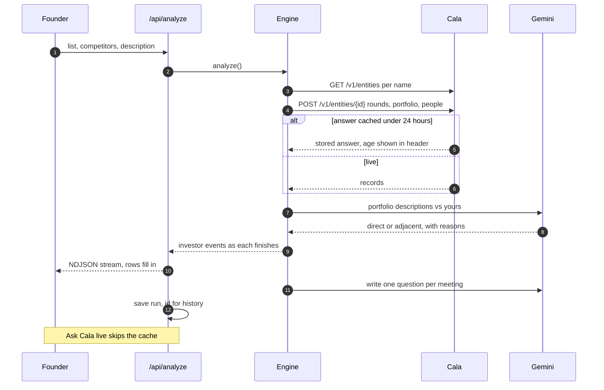
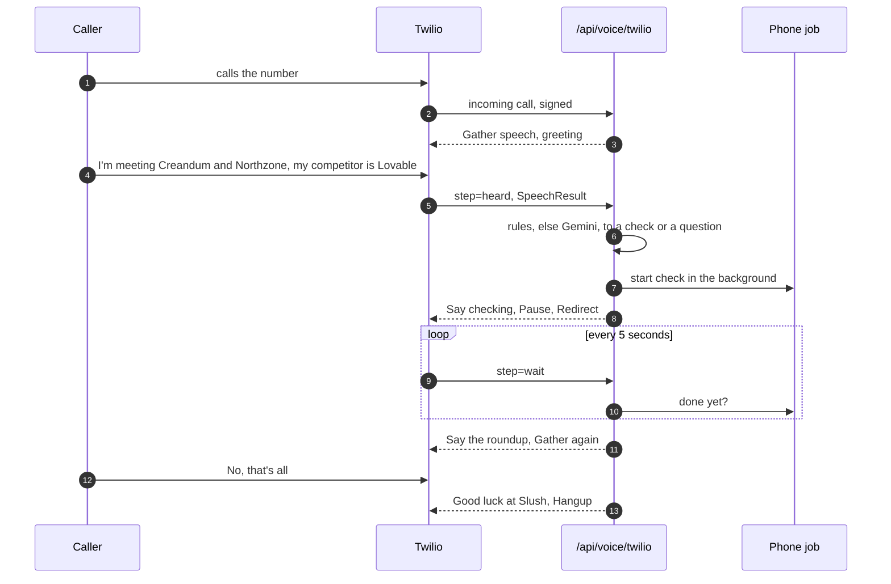
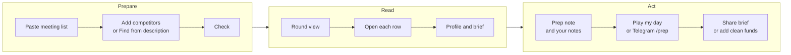

# FlipDD

**FlipDD checks a founder's investor meeting list against their competitors, so they know who already backed a rival before sending the deck.**

Some investors take a meeting to hear a pitch from a company that competes with one they already backed. FlipDD walks [Cala](https://cala.ai)'s knowledge graph for every investor on a founder's Slush list and gives each one a verdict, a share level (teaser, deck or data room) and a question to ask in the room. Everything is measured by one number: **round exposure**, the share of a founder's meetings that sit within one step of a competitor (0 to 100).

Built at Junction 2026 for Cala's *Make Unicorns Real* challenge · App: [tryflipdd.vercel.app](https://tryflipdd.vercel.app) · Telegram: [@tryflipdd_bot](https://t.me/tryflipdd_bot) · Demo: `<VIDEO_URL>` · Code: [github.com/mrnetwork0001/FlipDD](https://github.com/mrnetwork0001/FlipDD) (private, access on request)

**Judges, start here:** open [tryflipdd.vercel.app/app](https://tryflipdd.vercel.app/app), press **Load example**, then **Check 8 investors**. It checks 8 real funds against Lovable on Cala's graph with no account, in about a second because the answers are cached. Press **Prep** on Creandum for the meeting note, or **Play my day** to hear the whole round. On a phone, message [@tryflipdd_bot](https://t.me/tryflipdd_bot) `/check Creandum, Northzone vs Lovable`, then `/prep Creandum`.

---

## Four checks per investor, no login needed

| Check | What it finds | Try it |
| --- | --- | --- |
| **Direct stake** | The fund, its lender arm or an angel invested in a competitor. Each finding is dated from Cala's funding-round records, with the round name and whether they led it. A lead or recent stake means **Teaser only**. *Creandum led Lovable's Series B in December 2025.* | `/app` → **Load example** |
| **One step away** | The fund co-invests with someone who backs the competitor. The link is scored 0 to 100 from how many rounds they shared and how recently (`src/lib/scoring.ts`). *Northzone and Index Ventures both co-invest with Accel, which led Lovable's round.* | Open the Northzone row |
| **Lookalike** | A portfolio company that does what you do, though it isn't on your competitor list. Gemini judges it only from the descriptions Cala holds. | Open the Atomico row (Framer) |
| **People** | A partner who sits on a competitor's board or founded one. They are matched on the same person record in Cala, not just the same name. | Rows show a **Person** finding |

The whole list then gets a **round view** (`src/lib/roundRisk.ts`). It gives the round exposure score, the co-investor that ties several meetings to a competitor (the "hub"), the likeliest leads with no competitor stake, and a suggested order to take the meetings in, safest first.

### More to explore

| Feature | What it is | Where |
| --- | --- | --- |
| **Competitors** | Each competitor's recent rounds (amount, valuation, investors) and corporate events such as acquisitions, from Cala. | **Competitors** tab |
| **Find investors** | Funds that back companies *near* yours (same buyers, different product) and pass the same conflict checks. Backers of direct rivals are dropped, and the dropped list is shown. The example considered 58 and kept 6. | **Find investors** tab |
| **Slush 2026** | Searches Cala's Slush 2026 event (2,988 attendee companies) for your competitors and your investors' portfolio companies. | **Slush 2026** tab |
| **Meeting prep** | One note per investor, built only from Cala's graph. **In 30 seconds:** their stake in your space (and whether it blocks you), who you will likely meet, what to ask, what to hold back. Below it, folded: the partners' backgrounds, your competitor's ARR and headcount over time, how the fund invests, what Cala holds on *you*, their exits and who raised in your space this year. Your own notes and the outcome are saved per meeting. | **Prep** on any row |
| **Investor profile** | A sourced write-up from Cala's knowledge search: focus, recent deals and partners, with links. | On every shared meeting brief (`/brief/<id>`) |
| **Meeting brief** | A shareable, printable page per investor with the verdict, evidence and question. | Open a row → **Share meeting brief** → `/brief/<id>` |
| **Watchlist** | Follows your competitors' funding news for 90 days through Context.dev. | `/watch/<id>` |
| **Voice** | **Listen** to any briefing, or **Play my day** for every meeting in order, in an ElevenLabs voice (the browser's own voice is the fallback). | Investors tab, brief page |
| **Telegram** | `/check Creandum, Northzone vs Lovable`, then `/prep Creandum` for that meeting's note as text and an ElevenLabs voice note. Voice notes work too, and questions are answered from Cala's MCP server. | [@tryflipdd_bot](https://t.me/tryflipdd_bot), or the Telegram button bottom-right |
| **Phone line** | Call a Twilio number, say who you're meeting, and hear the result. Follow-up questions work on the same call. | The phone button bottom-right, once a number is set |
| **Your own Cala key** | If FlipDD's credits run out, or you want many checks, paste your own key. It stays in your browser and is sent only with your requests; anything already cached costs it nothing. | Under the form, or the button on a credits error |
| **MCP server** | FlipDD's own checks as tools for Claude or Cursor: `check_investors`, `find_competitors`, `find_clean_investors`, `investor_profile`, `slush_check`, `watch_news`. | `/api/mcp` |

Following Cala's feedback, the results page stays calm: one line for the round, one card per meeting with a **Prep** button, and the details (step log, conflict map, round breakdown) on request. Verdicts describe rather than alarm ("Backs your competitor", "One step away"), since backing competitors is normal for investors; the note is about using that, not avoiding them. The app works the same on phones. The form becomes a drawer, and the meeting list is a cart you add funds to from Find investors. **Recent checks** reopens any earlier run without asking Cala again. The header shows how many Cala calls were live and how old any cached answer is.

## Why Cala is essential

- **No graph, no second hop.** "Northzone co-invests with Accel, which led Lovable" needs the funds' round histories joined across companies. `leakPathsFor` in `src/lib/engine.ts` walks investor → round → co-investor → competitor through `POST /v1/entities/{id}` relationships.
- **No entity records, no person match.** A partner's board seat counts only when Cala links the same person record to both the fund and the competitor (`findPeople`, `src/lib/engine.ts`). Name matching alone would accuse the wrong John Smith.
- **No dated rounds, no share level.** Teaser only, or deck without customer names, depends on whether the stake was a lead and how recent it is. Both come from Cala's `FundingRound` records (`event_date`, lead flags, instrument).
- **No event entity, no Slush tab.** The Slush 2026 attendee list is a Cala entity (`src/lib/slush.ts`), read in pages of 1,000.
- **No introspection, no honesty about gaps.** `GET /v1/entities/{id}/introspection` tells FlipDD how much Cala holds on each investor. A fund with fewer than 5 records gets **Too little data** instead of a false "clear".

## Architecture

FlipDD is one Next.js 14 app. It has three layers:

- **Clients:** the web app, Telegram, the phone line, and MCP clients.
- **Engine:** `src/lib/engine.ts`, with Gemini for the judgements that need language.
- **Data:** Cala, which supplies all the facts, and a store that holds runs, briefs and caches (files locally, Upstash Redis on Vercel).

### System overview



Every client reaches the same engine. The web app streams a check as NDJSON (one JSON event per line), so each investor's row fills in as its checks finish. Cala is the only source of facts. Gemini only reads facts FlipDD has already pulled from Cala, and is told not to add any.

### Who holds which key



| Key | Lives in | Can | Can never |
| --- | --- | --- | --- |
| `CALA_API_KEY` | Server env | Read Cala's graph | Reach the browser: no client code reads it |
| `GEMINI_API_KEY` | Server env | Judge competition, write questions, plan the question agent's calls, transcribe voice notes | Add facts: prompts carry only Cala's records |
| `ELEVENLABS_API_KEY` | Server env | Speak briefings and Telegram voice replies (`/api/speak`, capped per visitor) | Reach the browser: audio comes through the server |
| A visitor's own Cala key | That visitor's browser | Run that visitor's checks (`x-cala-key` header) | Be stored or logged on the server |
| `TWILIO_AUTH_TOKEN` | Server env | Verify `X-Twilio-Signature` on every call webhook | Place calls: FlipDD only answers them |
| `TELEGRAM_WEBHOOK_SECRET` | Server env, Telegram | Prove an update came from Telegram | Read other chats |
| `FLIPDD_MCP_TOKEN` | Server env, your MCP client | Require a bearer token on `/api/mcp` | Unlock anything else |
| `KV_REST_API_TOKEN` | Server env | Store runs, briefs and caches | Be read by clients |

### One check, from list to verdicts



`analyze()` resolves every name first. A fund can match several Cala records ("Organization" and "Company" with the same name), so FlipDD reads up to 3 per name and merges them. Joint inputs like `a16z crypto + Andreessen Horowitz` count as one investor. The four checks then run in parallel per investor. The Slush search, coverage and finder start early so they overlap with the scans. Portfolio companies go to Gemini in chunks of 15, which returns only the direct and adjacent ones.

### A check, end to end



The founder sees results as they arrive, not at the end. Cala answers are cached for 24 hours (`CALA_CACHE_HOURS`), and the header shows how many calls were live. Ticking **Ask Cala live** skips the cache entirely. If Cala refuses the key (403) or it runs out of credits (402), the run stops with a clear message instead of reporting "no conflict" for everyone.

### The phone line



A call can't wait a minute on one request, so the check runs in the background (`waitUntil` on Vercel) while Twilio polls every 5 seconds. The job's state is saved to the shared store, so a poll that lands on another serverless instance still finds it. Telegram voice notes follow the same path: Gemini transcribes the note, `interpretSpoken` reads it, and the reply comes back in text plus a voice message (Gemini speech encoded to OGG/Opus with ffmpeg).

### Founder flow



No account, wallet or key is needed in the web app. History lives in the browser (`localStorage`), and the runs themselves are stored on the server under unguessable 12-character ids.

**A real run.** On 14 November 2026 at 12:51 UTC the built-in example ran with the cache off. It checked 8 funds against Lovable in 43.9 seconds with 90 live Cala calls:

- **Creandum:** direct stake (backed Lovable, February 2025). Teaser only.
- **Balderton Capital:** in Lovable's Series C (August 2026), not as lead.
- **Northzone and Index Ventures:** one step away through Accel.
- **The other four:** a lookalike in their portfolio.
- **Round exposure:** 41 out of 100.
- **Find investors:** 58 funds near the market, 6 clean, 8 dropped.
- **Slush 2026:** two companies close to the example's product (Codeplain and DevAlly) are attending.

## Safety and honesty

- **The AI never invents facts.** Gemini's prompts contain only records FlipDD pulled from Cala, and every finding in the app links back to its sources. The Ask agent answers only from tool results and lists every call it made.
- **Unknown is not clear.** Investors Cala can't find are **Not found in Cala**, and those with fewer than 5 records are **Too little data**. Neither is shown as clean.
- **A refused key is loud.** A 403, or a 402 when credits run out, stops the run with an explanation (`REFUSED_MESSAGE`, `CREDITS_MESSAGE` in `src/lib/cala.ts`) and clears the rows rather than showing them as clear. The app then offers **Use your own Cala key**.
- **A slow check stops cleanly.** When Cala's rate limit slows a fresh check down, it stops before Vercel's 300-second limit (270 seconds on the web, 250 on Telegram; `CHECK_BUDGET_MS`) and says so, instead of showing half-finished rows as verdicts. Everything fetched so far is cached, so running the same check again picks up where it stopped.
- **Professional facts only.** Meeting prep shows partners' roles, past companies and schools, and strips birth years and personal details even when Cala's description includes them.
- **The fullest record wins.** A firm can be a dozen Cala records (Seedcamp: the firm, "Seedcamp Limited", its GP and fund vehicles). FlipDD reads every exact match, lets the one with the most investments lead and merges the firm's own fund vehicles, so a thin duplicate can't hide a real stake.
- **Limits.** 12 investors and 6 competitors per check (`src/app/api/analyze/route.ts`). The Ask agent makes at most 10 Cala calls, one slow query at a time. Concurrency is 5 Cala calls and 6 Gemini calls by default, and phone checks stop after 4 minutes.
- **Webhooks are verified.** Twilio requests are checked with HMAC-SHA1 against `TWILIO_AUTH_TOKEN`, and the test matches Twilio's official library. Telegram updates must carry `TELEGRAM_WEBHOOK_SECRET`. Both lines can be limited to listed chats or callers (`TELEGRAM_ALLOWED_CHATS`, `TWILIO_ALLOWED_CALLERS`).
- **Tests.** 38 unit tests cover scoring, name matching, round risk, news matching, Telegram formatting, spoken text and phone webhooks. All 38 passed on 15 November 2026.

## What's real and what's simulated

| Real | Not real, or labelled |
| --- | --- |
| Every investor, round, person and company comes from Cala during the run | If no run has been saved yet, the landing page shows an illustration labelled "Illustration" |
| Gemini's competition judgements, written questions and transcripts; ElevenLabs speech | Cached Cala answers (up to 24 hours old), with their age shown in the header |
| Context.dev news articles in the watchlist | `TELEGRAM_DRY_RUN=1` writes bot replies to a log instead of sending them (local testing only) |
| Telegram, Twilio and MCP requests run the same engine as the web app | Nothing is simulated in a check itself |

## Tech stack

Next.js 14.2 (App Router) on Vercel · React 18 · TypeScript (strict) · Tailwind CSS · Cala REST API and MCP server · Gemini (newest Flash model, picked automatically) · ElevenLabs (Flash v2.5) · Context.dev News API · Telegram Bot API (webhook) · Twilio Programmable Voice with Amazon Polly neural voices · Upstash Redis · ffmpeg-static · Remotion for the demo film · Node test runner with native TypeScript.

## Run it locally

**Prerequisites:** Node 22 or newer, a Cala API key (console.cala.ai, credit code `MAKEUNICORNSREAL`) and a Gemini API key.

```bash
npm install
cp .env.example .env.local   # then fill in the keys below
npm run dev                  # http://localhost:3001
npm test                     # unit tests
npm run typecheck
```

| Variable | What it does | When unset |
| --- | --- | --- |
| `CALA_API_KEY` | All facts | Checks refuse to run |
| `CALA_CACHE_HOURS` | How long Cala answers are reused (default 24) | 24 |
| `CALA_MAX_CONCURRENT` | Parallel Cala calls (default 5) | 5 |
| `CHECK_BUDGET_MS` | How long a check may run before it stops cleanly | 270000 on the web, 250000 on Telegram |
| `GEMINI_API_KEY` | Competition judgement, meeting questions, the question agent, voice-note transcription | Lookalike check uses shared words; questions and voice notes are off |
| `GEMINI_MODEL`, `GEMINI_MAX_CONCURRENT` | Force a model; parallel calls (default 6) | Newest Flash model; 6 |
| `ELEVENLABS_API_KEY`, `ELEVENLABS_VOICE_ID`, `ELEVENLABS_SPEED` | Briefings and Telegram voice notes (default voice Liam, 1.15×) | Browser voice in the app; Gemini speech on Telegram |
| `GEMINI_TTS_MODEL`, `GEMINI_TTS_VOICE` | Fallback Telegram speech (default voice Kore) | Newest Flash TTS model |
| `NEXT_PUBLIC_TELEGRAM_BOT`, `NEXT_PUBLIC_PHONE_NUMBER` | The Telegram and phone buttons (built in at deploy time) | `tryflipdd_bot`; the phone button explains the line until a number is set |
| `CONTEXT_DEV_API_KEY` | Watchlist news | Watchlist is off |
| `KV_REST_API_URL`, `KV_REST_API_TOKEN` | Shared store on Upstash Redis | Files under `FLIPDD_DATA_DIR` |
| `FLIPDD_DATA_DIR` | File store location | `.cache/` (or `/tmp/flipdd` on Vercel) |
| `FLIPDD_PUBLIC_URL` | Links in bot replies and previews | Relative links |
| `FLIPDD_MCP_TOKEN` | Bearer token for `/api/mcp` | MCP is open |
| `TELEGRAM_BOT_TOKEN`, `TELEGRAM_WEBHOOK_SECRET`, `TELEGRAM_ALLOWED_CHATS` | Telegram bot | Bot is off |
| `TWILIO_AUTH_TOKEN`, `TWILIO_ACCOUNT_SID`, `TWILIO_ALLOWED_CALLERS`, `TWILIO_VOICE` | Phone line | Signatures are not checked |

**Test status** (15 November 2026):

```
ℹ tests 38
ℹ pass 38
ℹ fail 0
```

## Deploying

1. **Vercel.** Import the repository. `next.config.mjs` bundles the illustrations and the ffmpeg binary into the functions that read them at runtime. Long routes declare `maxDuration = 300`.
2. **Storage.** Add an Upstash Redis database from Vercel's Storage tab. It sets `KV_REST_API_URL` and `KV_REST_API_TOKEN`. Without it, saved runs and shared briefs live in one instance's `/tmp` and disappear.
3. **Variables.** Add the keys from the table above, and set `FLIPDD_PUBLIC_URL` to the deployment address.
4. **Check.** `/api/health` lists which features are configured (yes or no only) and whether storage is shared.
5. **Warm.** Run `node scripts/warm.mjs <url>` once. It runs the example so the landing page shows a real result and the first checks are quick.
6. **Telegram.** Create a bot with @BotFather, set `TELEGRAM_BOT_TOKEN` and `TELEGRAM_WEBHOOK_SECRET`, redeploy, then run `node scripts/telegram-webhook.mjs <url>`. Telegram then calls `/api/telegram` directly: no server or polling process needed.
7. **Phone.** Buy a Twilio number, set `TWILIO_ACCOUNT_SID`, `TWILIO_AUTH_TOKEN` and `NEXT_PUBLIC_PHONE_NUMBER`, redeploy, then run `npm run twilio <number>` (or set the number's "A call comes in" webhook to `POST /api/voice/twilio` in the Twilio console).

A long-running server also works: `railway.json` and `nixpacks.toml` (which installs ffmpeg) are included. Set `FLIPDD_DATA_DIR` to a persistent volume.

## Repository map

```
src/
  app/
    page.tsx                  landing page, hero drawn from the latest real run
    app/page.tsx              the app: form, tabs, rows, history, meeting list
    brief/[id]/               shareable meeting brief
    watch/[id]/               competitor news watchlist
    lab/                      background effects preview
    api/
      analyze/                runs a check, streams NDJSON, saves the run
      prep/                   meeting prep: core facts, exits, market raises
      speak/                  ElevenLabs speech for Listen and Play my day
      ask/                    question agent (used by Telegram and the phone line)
      discover/               competitors from a description
      dossier/                sourced investor profile
      slush/                  the Slush 2026 event
      brief/ run/[id]/ watch/ saved documents
      mcp/                    FlipDD as an MCP server
      telegram/               bot webhook
      transcribe/             speech to text
      voice/twilio/           phone line
      health/                 feature and storage status
      art/                    which illustrations exist
  lib/
    engine.ts                 the checks, verdicts, share levels, finder
    cala.ts                   Cala client, cache, concurrency, refused key
    calaMcp.ts                Cala MCP client
    prep.ts                   meeting prep from the graph: team, stake signal, rival curves, your record
    askAgent.ts               question agent over Cala's MCP server (Gemini function calling)
    elevenlabs.ts             ElevenLabs speech (MP3 for the app, Ogg Opus for Telegram)
    calaKey.ts contact.ts     visitor's own Cala key; Telegram and phone links
    gemini.ts                 model choice, JSON calls, competition judge
    slush.ts                  Slush 2026 attendees and matching
    roundRisk.ts              round exposure, hubs, meeting order
    scoring.ts                link strength and recency
    names.ts                  company name matching
    dossier.ts discover.ts    profiles and competitor discovery
    watch.ts contextdev.ts newsMatch.ts   watchlist news
    voiceScript.ts            spoken briefings and spoken-request parsing
    voice.ts                  Gemini transcription and speech, Opus encoding
    telegram.ts telegramText.ts           Telegram bot
    twiml.ts phoneCall.ts     phone line TwiML, signatures, jobs
    store.ts                  files or Upstash Redis
    client/                   browser-side speech player and own-key fetch
    showcase.ts example.ts    landing page run and built-in example
    types.ts                  shared types
  components/                 MeetingPrepPanel, ContactDock, OwnCalaKey, panels, conflict map, live scan, voice buttons, glyphs
scripts/                      warm, telegram polling and webhook, twilio setup
tests/                        unit tests (node --test)
video/                        the demo film pipeline (Remotion): script.json, scenes, live-site capture, voice, music,
                              sound and timing scripts, real-run data, stock footage list (data/stock.json)
public/brand/                 logos and illustrations
```

## Data and content

FlipDD names real funds and companies only as Cala records them, with sources. A verdict says what the records show, such as "led Lovable's Series B, December 2025". It never says what an investor intends. The landing page's showcase skips funds that should not be shown with a red verdict in public (`NO_NEGATIVE` in `src/lib/showcase.ts`).

## Pre-existing work and credits

- **Scaffold:** a standard Next.js 14 app with Tailwind. No prior FlipDD code.
- **Data:** [Cala](https://cala.ai) (knowledge graph, knowledge search and MCP server), [Context.dev](https://context.dev) (news).
- **AI:** Google Gemini (judgement, questions, agent, transcription, fallback speech) and ElevenLabs (briefings, Play my day, Telegram voice notes).
- **Telephony:** Telegram Bot API, and Twilio with Amazon Polly voices.
- **Libraries:** `lucide-react` icons, `@vercel/functions`, `ffmpeg-static` (ffmpeg is LGPL/GPL licensed).
- **Illustrations:** generated for this project.
- **Demo film:** made with Remotion from real recordings of the live app and the bot's real replies. People on camera are stock footage from [Mixkit](https://mixkit.co) under its free licence; voices and music by ElevenLabs.

## License

All rights reserved by the FlipDD team unless a license file is added.

---

FlipDD reports what Cala's records show. It is not investment, legal or financial advice. Check anything you act on with the investor directly.
